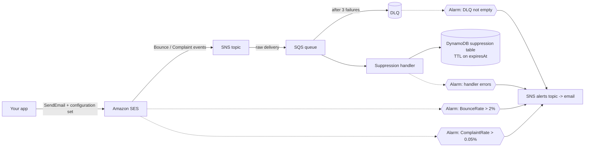

# SES Feedback Loop Guardrails

> Companion repo for the article: [El domingo que SES nos pausó el envío de correos (ES)](#) · [EN version](#)

An Amazon SES feedback loop that keeps your own suppression list up to date and tells you when something goes wrong, **before** AWS puts your account under review. SES bounce and complaint events flow through SNS and SQS into a Lambda function that writes to a DynamoDB suppression table: permanent bounces and complaints are suppressed forever, while transient and undetermined bounces expire after one day thanks to DynamoDB TTL. CloudWatch alarms watch the dead-letter queue, the handler errors and the account's `Reputation.BounceRate` and `Reputation.ComplaintRate`.

## Architecture



### Suppression rules

| SES event | `bounceType` | Suppressed for |
|---|---|---|
| Bounce | `Permanent` (any subtype) | Forever |
| Bounce | `Transient` (any subtype) | 1 day |
| Bounce | `Undetermined` | 1 day |
| Complaint | — | Forever |

The rule is decided by `bounceType`, never by `bounceSubType`: `General` exists under both `Permanent` and `Transient`. A permanent entry is never downgraded to a temporary one.

## Prerequisites
- Node.js 20+
- AWS CLI configured
- An email address you can open (SES sends a verification link to it)

The AWS CDK CLI is installed as a dev dependency, so `npx cdk` works without a global install. The demo works inside the SES sandbox because it only sends to the [mailbox simulator](https://docs.aws.amazon.com/ses/latest/dg/send-an-email-from-console.html#send-email-simulator).

## Deploy

```bash
npm install
npx cdk bootstrap   # first time only, per account and region
npx cdk deploy \
  -c senderEmail=you@example.com \
  -c alertEmail=you@example.com
```

After the deploy:
1. Click the SES verification link sent to `senderEmail`.
2. Confirm the SNS subscription sent to `alertEmail`.

## Try it

```bash
./scripts/send-test-emails.sh
```

The script sends one email to `bounce@simulator.amazonses.com` and one to `complaint@simulator.amazonses.com` using the configuration set, waits 30 seconds and scans the suppression table. You should see two items:

- `bounce@simulator.amazonses.com`: reason `BOUNCE`, type `Permanent`, no `expiresAt` (suppressed forever).
- `complaint@simulator.amazonses.com`: reason `COMPLAINT`, no `expiresAt`.

If the table is empty, check the Lambda logs and the DLQ.

Mailbox simulator emails do not count toward your bounce or complaint rate.

### Bonus: is my account paused?

SES does not emit an EventBridge event when it pauses your account. Check the enforcement status instead (`HEALTHY`, `PROBATION` or `SHUTDOWN`):

```bash
aws sesv2 get-account --query EnforcementStatus --output text
```

## Run the tests

```bash
npm test        # unit tests for the rules + CDK assertions
npm run build   # type check
npx cdk synth
```

## Cost
For a demo with a handful of test emails, expect **less than USD 1 per month**:
- 4 CloudWatch standard alarms: ~USD 0.10 each per month (the main cost).
- SES: USD 0.10 per 1,000 emails.
- SNS, SQS, Lambda and DynamoDB on-demand: within the free tier at this volume.

Prices change by region; check the AWS pricing pages before deploying.

## Cleanup

```bash
npx cdk destroy
```

This removes every resource, including the suppression table and its data. The CDK bootstrap stack (`CDKToolkit`) stays in your account.

## Notes
This is a demo. Review IAM policies, limits and costs before using it in production. In particular:
- The table uses `RemovalPolicy.DESTROY`. In production, keep your suppression list (`RETAIN`) and enable point-in-time recovery.
- Point the alerts topic to a channel someone actually reads on weekends.
- Your sending code still needs to check the suppression table before calling SES.

## License
MIT
